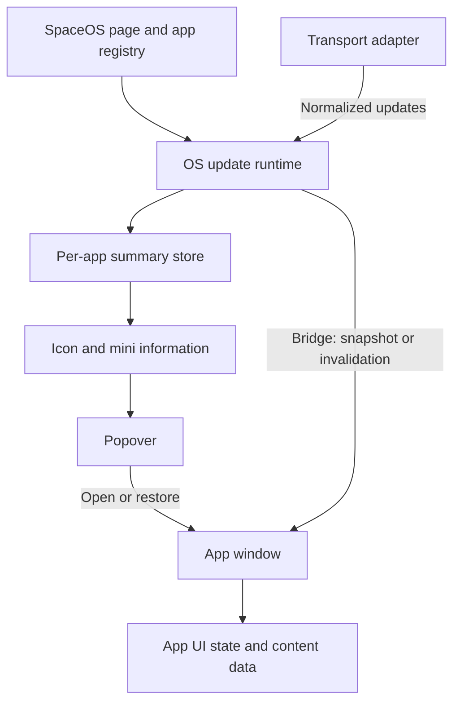

# App update workflow within SpaceOS

Status: target design for an open SpaceOS page; the shared runtime is not implemented. Backend event production and transport selection will be researched later. Use this workflow to define responsibilities and UX, not as an existing SDK.

## Intended outcome

Apps update content and toolbar mini information through an OS-owned runtime. Closing or minimizing a window preserves required toolbar status. Reopening an app must not multiply connections or lose filters.

Keep independent apps supporting iframe and standalone use under the [layout standard](./spaceos-embedded-app-layout.md). Sessions determine access and summary semantics must be explicit. This stage defines workflow, not a broker, producer, transport implementation, or out-of-page behavior. MQTT is a candidate adapter, not a selected broker.

Workflow acceptance requires clear connection ownership, app registration, toolbar/content distribution, open/close/restore behavior, and connection recovery, with current behavior distinguished from the target.

## Participants

| Component | Responsibility |
|---|---|
| OS app registry | App ID, OS-owned icon, summary capability, and opening action |
| Transport adapter | Connection and normalization; MQTT topic or other endpoint mapping |
| OS update runtime | One connection per OS page, required subscriptions, validation/distribution, and recovery |
| OS summary store | Latest in-memory summary per app, revision, and synchronization state |
| Toolbar/popover | Present summaries under OS rules and open/restore the destination |
| Embedded app | Own UI state, receive bridge invalidations, and load/update its content |

An OS session here means one loaded OS page. Each OS tab may have its own connection initially; cross-tab sharing is a later optimization. Closing an app window is different from closing the OS page.

No continuous processing is guaranteed while the OS page is hidden, frozen, discarded, or closed. Reconcile when it returns before claiming current data. Native background agents and out-of-page notifications are outside scope.

Zustand may implement the OS summary store, while iframe stores remain separate instances. Do not pass upstream tokens or share a store object through the bridge. Do not create connections during Next.js server rendering or per toolbar icon.

Standalone apps have their own page runtime/lifecycle under the same access contract. Embedded apps use the OS owner once the new contract exists, without a duplicate push connection for the same need.

## Operational flow

1. **Initialize OS.** Read registry/display preferences. An icon may show connecting without a fabricated count. Start the runtime only with valid access context.
2. **Register data needs.** Combine channels for open apps and enabled toolbar status. Registry channels are logical names; adapters map them to transport destinations. Server policy grants actual access.
3. **Bootstrap consistently.** Obtain a revisioned snapshot followed by changes, or another bootstrap with a consistent snapshot/event boundary. Become live only after valid baseline data. Source handshake details belong to backend design.
4. **Receive changes.** Validate session, registered app/channel, structure, identity, and revision. Reject obsolete/duplicate updates. A valid summary replaces the previous value; do not increment counts for each message.
5. **Update surfaces.** Change only the relevant summary. Deliver a small snapshot or invalidation through a bridge validating origin/source/instance. Detail content remains app-owned.
6. **Handle user actions.** Icons open popovers; the primary action opens/restores the app. Load authorized data using current context while preserving filters, dates, and reading position. Mutations use authenticated APIs; source-confirmed changes then reconcile surfaces.
7. **Recover.** Reconnect and reconcile snapshots/revisions after interruptions or page return. Show resynchronization in progress. Stop and clear user-bound data when access context ends.

Healthy event-capable sources update UI through events. Initial loading, on-demand content, and reconciliation remain distinct requests. Any periodic fallback must be centrally coordinated and explicit.

Five-second polling is not the default target. Until a real feed exists, label current polling honestly. Push does not remove recovery requirements. Coalesce invalidations and bound reloads so bursts do not trigger every window simultaneously; measure thresholds with the source.

## Window and data lifecycle

| Action | Channels/summary | App content |
|---|---|---|
| App closed, status enabled | Runtime receives toolbar summary | Detail lists need not load |
| Open app | Reuse existing channel | Bridge handshake, baseline, then changes |
| Minimize | Toolbar channel continues | Preserve UI; defer detail work and track invalidation |
| Restore | Use current summary | Reconcile changed content before claiming freshness |
| Close window | Keep summary if status enabled | Release window consumer; closing does not mark read |
| Disable status with no open app | Release unused channel | No remaining UI consumer |
| Disconnect | Mark summary unsynchronized; stop claiming current counts | Preserve filters; distinguish transport failure from source/access failure |
| Revoke one app | Clear its summary/channel | Clear its content; authorized apps remain usable |
| Logout/change user | Stop old channels; purge old summaries/queued data | Remove old-user content before new-user data |

Reject late callbacks from old contexts. Compare revisions only within their defined source/context, never across unrelated apps.

## Update semantics and UX

Three meanings are required; wire message names/schemas remain undecided:

- **Snapshot:** current baseline for initialization or recovery.
- **Summary replacement:** replace count/status/progress with a newer revision.
- **Invalidation:** identify content requiring an authorized reload without sending whole lists through the OS.

The future contract needs schema version, app/channel, update kind, source identity/revision, and freshness metadata. Separate observation time from business event time. Freshness policy depends on data: silence from a stable value is not automatically failure, and an old retained snapshot does not establish connection health.

Separate session, message, and business identity. Frame sequence/fetch counts are not source revisions or cursors. Snapshot and event boundaries must be consistent; gaps or unknown order require reconciliation. Transport acknowledgment is neither read-state nor business completion.

Toolbar values are bounded count/progress/status data. Registry owns icons and OS owns localized labels. Do not render app HTML or arbitrary URLs. Popovers show state, freshness, and one primary action under the [toolbar rules](./spaceos-notifications-and-app-status.md#three-os-information-layers).

Coalesce updates where appropriate. Do not move icons, open windows, toast every message, or jump reading positions. Offer a user-controlled action to reveal new content when needed.

**Notifications example:** a new summary reports the snapshot event count; the bell updates; staff open a popover and then the app. Preserve topic filters when content changes. Legacy data proves event count, not new-event detection or unread state. [Business semantics](./employee-experience.md#count-semantics) separates these meanings.

## Transport follows workflow

| Component | Role and selection boundary |
|---|---|
| Backend broker | Producer/consumer distribution when needed; not mandatory for every app |
| SSE or WebSocket | Browser delivery options selected by directionality, hosting, and recovery needs |
| MQTT | Publish/subscribe over WebSocket in browsers; adapter maps topics into logical runtime channels |
| Service Worker | Event-based lifetime, not a guaranteed daemon for a persistent connection |

MQTT and WebSocket are not mutually exclusive: [MQTT.js](https://github.com/mqttjs/MQTT.js) supports browser MQTT over WebSocket. A backend broker can also feed an SSE/WebSocket gateway. Preserve authenticated snapshot/mutation APIs; a broker replaces neither the database nor authorization.

A shared event contract does not imply one global topic exposing all staff data. Use domain/audience channels, server-side subscribe/delivery authorization, and revocation. Browser MQTT credentials, if chosen, must be short-lived, ACL-scoped, and separate from upstream tokens. Never embed internal broker credentials. Follow the [session architecture](../architecture/platform-foundation.md).

Before choosing MQTT, verify deduplication/order, replay or snapshot reconciliation, non-conflicting client identities across tabs, queue/expiry bounds, and retained-data meaning. Retained/QoS does not create inbox history, read-state, or correct mutations. Do not settle broker, QoS, or retention without producers and an operations owner.

An OS client runtime separates updates from window lifecycle without a Service Worker. Worker execution is optional if measured needs justify it. The [W3C lifetime contract](https://www.w3.org/TR/service-workers/#service-worker-lifetime) permits event-bound workers to stop, so it cannot guarantee an always-live connection.

## Current implementation and transition

[AppStatusTray](../../components/desktop/app-status-tray.tsx) owns a separate `/status` iframe. [StatusChannel](../../apps/notifications/components/status-channel.tsx) uses the [source hook](../../packages/embedded-app/src/use-source.ts) to poll every 60 seconds according to visibility. The [parser](../../lib/desktop/app-status.ts) owns validation/TTL. This is bridge v1 with snapshot heartbeats, not a shared push runtime with source revisions. Real source session integration remains outstanding.

Only one component may own an app summary. Transfer ownership from the status iframe to the shared runtime explicitly. Preserve exact origin/source validation and version new messages; this design does not extend v1 through documentation alone.

Keep independent Next.js/shadcn apps and per-instance UI state. Future backend work must provide authorized context, consistent bootstrap, identity/revisioned changes, and reconciliation. An MQTT adapter would map topics/retained/event behavior to the same workflow.

## Next implementation steps

1. Settle app registry/status metadata and UX states.
2. Define runtime/store/bridge contracts and validate open/minimize/close/restore, reconnect, and session changes with test-only fixtures.
3. Research backend producers, select transport, and connect one real Notifications flow before expanding.

Acceptance requires no duplicate connections per window, current state on reopening, rejection of obsolete summaries, no false zero on errors, and no old-session callbacks updating a new session. Set freshness and source thresholds with backend owners.
